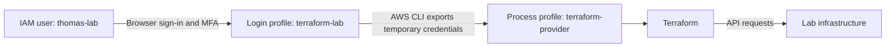

# AWS Setup for the Terraform ALB Lab

Prepare a personal AWS learning account and your Mac before following [INSTRUCTIONS.md](INSTRUCTIONS.md). See [README.md](README.md) for the lab specifications.

Allow approximately 30–60 minutes in addition to the two-hour lab. Account verification may take longer. If you use an employer's account, follow its approved login and permission process.

This guide follows the standalone IAM-user and browser-login method used in this lab. AWS generally recommends federated identities with temporary credentials for human access; this lab uses an IAM console user with temporary CLI credentials. You do not need to enable IAM Identity Center or create an AWS Organization for this path.

**Free Tier consideration:** AWS documents that creating an Organization upgrades a Free Tier account to a paid plan and immediately expires its Free Tier credits. Review the terms before taking that route. [AWS Identity Center documentation](https://docs.aws.amazon.com/singlesignon/latest/userguide/enable-identity-center.html).

## 1. Create and secure your account

1. Sign up at [AWS](https://aws.amazon.com/), completing payment and identity verification.
2. Sign in as root using the email address used to create the account.
3. Open the account menu → **Security credentials** → **Multi-factor authentication** → **Assign MFA device**.
4. Register a supported authenticator, passkey, or security key.

MFA adds a verification method beyond your password. The root user owns the account and has full control. Keep it for initial setup and account-owner tasks; do not create root access keys.

References: [Root MFA](https://docs.aws.amazon.com/IAM/latest/UserGuide/enable-mfa-for-root.html), [Root-user best practices](https://docs.aws.amazon.com/IAM/latest/UserGuide/root-user-best-practices.html).

## 2. Set a spending alert

1. Open **Billing and Cost Management → Budgets → Create budget**.
2. Create a monthly cost budget, for example **US$5**.
3. Add email notifications at your chosen thresholds, such as 50% and 100%.
4. Open the created budget and confirm the notification recipients and thresholds.

A budget sends alerts; it does not cap spending. Notifications can lag behind usage. The lab can charge for the ALB, EC2, storage, public IPv4 addresses, and data transfer. Remove resources afterward with `terraform destroy`.

References: [Create a cost budget](https://docs.aws.amazon.com/cost-management/latest/userguide/create-cost-budget.html), [Budget notification limitations](https://docs.aws.amazon.com/cost-management/latest/userguide/budgets-managing-costs.html).

## 3. Create your everyday IAM login

An everyday login is a separate identity within the same AWS account, not another AWS account.

1. While signed in as root, search for **IAM**. Open IAM, not IAM Identity Center.
2. Choose **Users → Create user**.
3. Use a username such as `thomas-lab`.
4. Enable **AWS Management Console access**, choosing an IAM user if offered a choice with Identity Center.
5. Set a password. If **Require password reset** is enabled, change it on first sign-in.
6. On the permissions step, choose **Attach policies directly** and select `AdministratorAccess`.
7. Create the user and save the console sign-in URL.
8. Sign out of root or open a private browser window. Open that URL and sign in as `thomas-lab`.
9. Enable MFA for this user under **Security credentials**.

`AdministratorAccess` is broad access for this dedicated learning account, not a restricted permission set. Narrow permissions as you learn IAM. Do not use this recommendation for a shared or production account.

No long-lived access keys are needed. AWS's browser-login flow uses temporary credentials. The documented `SignInLocalDevelopmentAccess` permission is included by the broader administrator policy; restricted users may need that policy added separately.

References: [Create an IAM user](https://docs.aws.amazon.com/IAM/latest/UserGuide/id_users_create.html), [AWS CLI browser-login prerequisites](https://docs.aws.amazon.com/cli/latest/userguide/cli-configure-sign-in.html).

## 4. Install AWS CLI and Terraform

### AWS CLI

Use the macOS instructions in the [official AWS installation guide](https://docs.aws.amazon.com/cli/latest/userguide/getting-started-install.html). The script method downloads and runs AWS's installer:

```sh
curl -fsSL https://awscli.amazonaws.com/v2/install.sh | bash
```

Alternatively, that guide links the [macOS GUI installer](https://awscli.amazonaws.com/AWSCLIV2.pkg).

Reopen your terminal and verify:

```sh
aws --version
```

`aws login` requires **AWS CLI 2.32.0 or newer**.

### Terraform

If Homebrew is installed:

```sh
brew tap hashicorp/tap
brew install hashicorp/tap/terraform
terraform version
```

Otherwise, use [HashiCorp's installation instructions](https://developer.hashicorp.com/terraform/install).

## 5. Create a local login profile

```sh
aws login --profile terraform-lab
```

Choose **Ohio (`us-east-2`)** when prompted for the region, matching the lab walkthrough. In the browser, sign in as `thomas-lab`, complete MFA, and authorize the login. Select the IAM user rather than root if multiple sessions appear.

The profile name is a local label you choose. `terraform-lab` does not need to match the AWS username `thomas-lab`. Profiles live on your Mac, not in the AWS console. The command creates or configures the named profile during login.

```sh
aws configure list-profiles
aws sts get-caller-identity --profile terraform-lab
```

An empty profile list before login means no local profiles have been configured. After login, expect `terraform-lab` to appear. Verify the identity check shows the intended account and user.

AWS profile settings are in `~/.aws/config`. Browser-login sessions are cached in `~/.aws/login/cache`. Do not share credential files or cache contents.

Reference: [AWS browser-login documentation](https://docs.aws.amazon.com/cli/latest/userguide/cli-configure-sign-in.html).

## 6. Connect the profile to Terraform

Follow step 2 in [INSTRUCTIONS.md](INSTRUCTIONS.md) to create a distinct `terraform-provider` profile using AWS's documented process-credentials bridge. It lets Terraform obtain temporary credentials from the `terraform-lab` login.



When the session expires, renew it with `aws login --profile terraform-lab`. In a new terminal, set `AWS_PROFILE=terraform-provider` before running Terraform.

## Troubleshooting

| Symptom | Action |
| --- | --- |
| `aws: command not found` | Install AWS CLI, reopen the terminal, and check the installer's PATH instructions. |
| `aws login` is unavailable | Check `aws --version`; update to at least 2.32.0. |
| `terraform: command not found` | Install Terraform and reopen the terminal. |
| Profile list is empty | Complete `aws login --profile terraform-lab`. |
| Browser shows Identity Center setup | This lab uses IAM users; open IAM → Users instead. |
| Login session expired | Repeat `aws login --profile terraform-lab`. |
| Login is denied | Check the selected IAM identity and its local-development sign-in permission. |
| Terraform cannot find credentials | Complete the process-profile step in INSTRUCTIONS.md and set `AWS_PROFILE=terraform-provider`. |
| Unexpected account or identity | Stop before provisioning and check the profile and any existing credential environment variables. |

Setup is ready when MFA and budget alerts are configured, both tools work, and the identity check succeeds. Continue with [INSTRUCTIONS.md](INSTRUCTIONS.md); Terraform will create the VPC, instances, and ALB.
