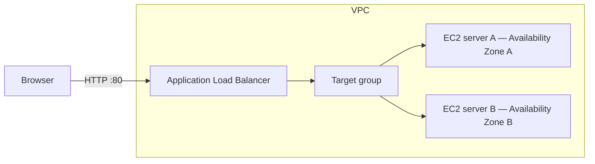
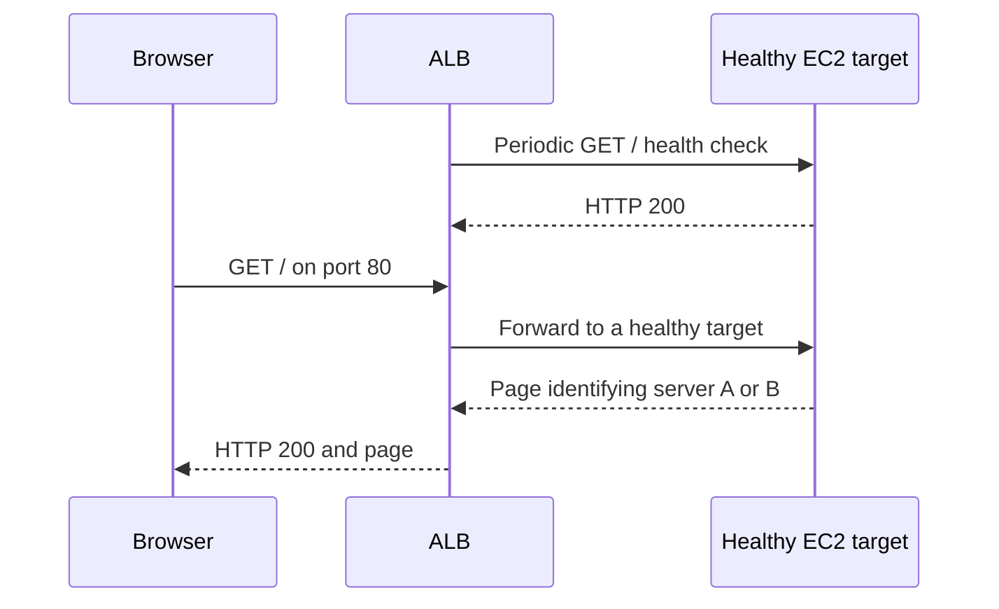
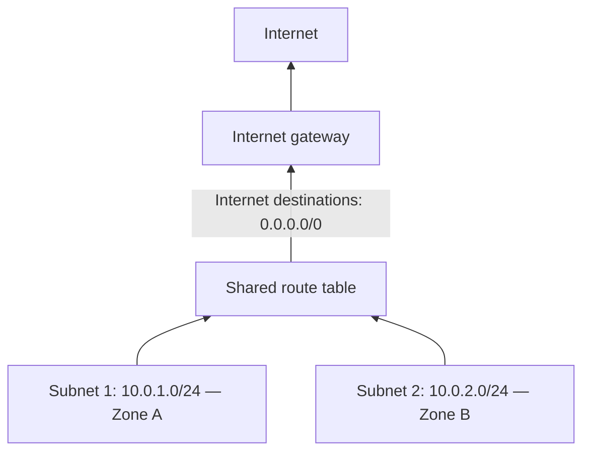
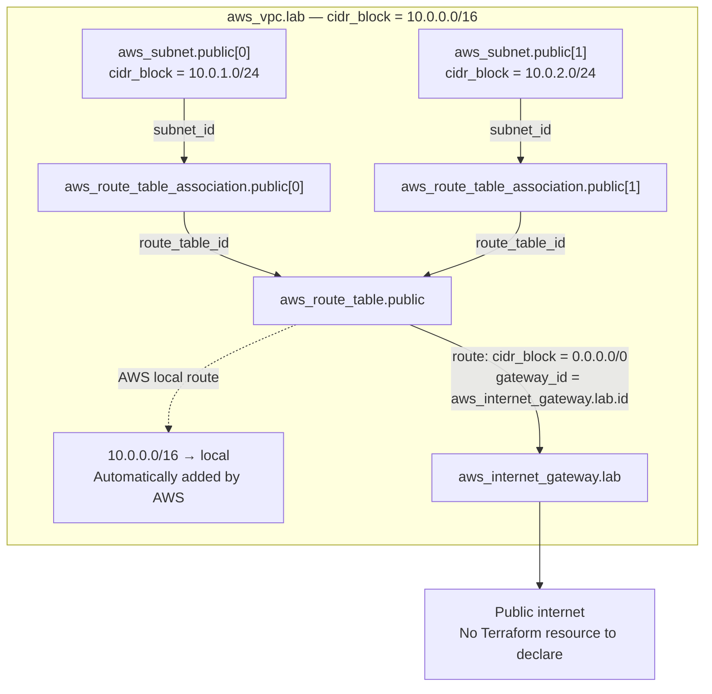
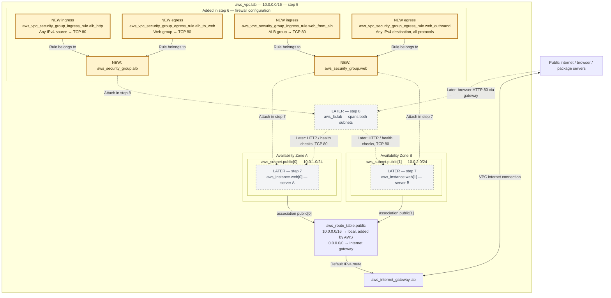

# Terraform ALB Lab: Step-by-Step Instructions

Build one public endpoint backed by two web servers, then stop one server and observe how the Application Load Balancer (ALB) routes requests to the remaining healthy server.

Allow approximately two hours after completing [AWS setup](AWS_SETUP.md). See [README.md](README.md) for the specifications and learning outcomes.

Track your completed steps in the [README lab progress checklist](README.md#lab-progress).

This is a walkthrough: copy the examples into the indicated files as you work. The Terraform files are not created by this document. Commands run in your local terminal; Terraform creates the infrastructure through AWS APIs.

The lab creates billable resources. Complete the cleanup step when finished.

## Architecture and request flow



The target group is a collection of destinations, not another server. The ALB forwards requests directly to registered targets.



## 1. Open the project and select your AWS profile

| Command / setting | Purpose |
| --- | --- |
| `AWS_PROFILE=terraform-lab` | Select the existing local login profile; this is not a Terraform resource. |
| `aws sts get-caller-identity` | Confirm the AWS account and identity used by the terminal. |
| `terraform version` | Confirm Terraform is installed. |

```sh
cd /Users/thomasfung/src/terraform-alb-lab
export AWS_PROFILE=terraform-lab
aws sts get-caller-identity
terraform version
```

Replace `terraform-lab` if you chose another login profile name. Verify that the identity output shows your intended learning account and IAM user, rather than root.

We use **Ohio (`us-east-2`)** throughout this walkthrough. Select Ohio in the AWS console too.

## 2. Make your browser login available to Terraform

| Local configuration | Purpose |
| --- | --- |
| `terraform-lab` profile | Hold the browser-login configuration used to obtain temporary credentials. |
| `terraform-provider` profile | Obtain credentials from the login profile using `credential_process`. |
| `AWS_PROFILE=terraform-provider` | Select the process profile for Terraform; no AWS infrastructure is created in this step. |

Some development tools need a compatibility profile to use credentials from `aws login`. Use AWS's documented `credential_process` bridge:

```sh
aws configure set credential_process \
  'aws configure export-credentials --profile terraform-lab --format process' \
  --profile terraform-provider

aws configure set region us-east-2 --profile terraform-provider

export AWS_PROFILE=terraform-provider
aws sts get-caller-identity
```

`terraform-provider` asks the AWS CLI for temporary credentials from your existing `terraform-lab` login. Replace the login profile name inside the quoted command if yours differs. Use two distinct names; a process profile must not point back to itself.

Set `AWS_PROFILE=terraform-provider` again in each new terminal. If your session expires, renew the underlying login with `aws login --profile terraform-lab`.

Reference: [AWS browser-login and process-credentials documentation](https://docs.aws.amazon.com/cli/latest/userguide/cli-configure-sign-in.html).

## 3. Create the project files

| File / declaration | Reference | Purpose |
| --- | --- | --- |
| `main.tf` | — | Hold the provider, data sources, and infrastructure declarations added in later steps. |
| `variable "aws_region"` in `variables.tf` | `var.aws_region` | Supply the configurable AWS region, defaulting to Ohio. |
| `outputs.tf` | — | Hold output declarations added in step 8. |
| `.gitignore` | — | Keep downloaded providers, state, and saved plans out of Git. |

If you ran `terraform init` before creating the configuration, you may see:

```text
Terraform initialized in an empty directory!

The directory has no Terraform configuration files.
```

This means Terraform is installed and can run, but the current directory has no `.tf` configuration to initialize. It has not downloaded the AWS provider or created AWS resources. Continue below to create and populate the files, then run `terraform init` again in step 4.

```sh
touch main.tf variables.tf outputs.tf .gitignore
```

`touch` creates empty files; it does not add Terraform configuration. Open them in your editor and save the contents shown below. Add the variable definition to `variables.tf` in this step and the provider configuration to `main.tf` in step 4. Leave `outputs.tf` empty until step 8.

Put this in `.gitignore`:

```gitignore
.terraform/
*.tfstate
*.tfstate.*
*.tfplan
crash.log
```

State records the resources Terraform manages. Keep it locally until cleanup is complete; do not commit it.

Put this in `variables.tf`:

```hcl
variable "aws_region" {
  description = "AWS region for the lab"
  type        = string
  default     = "us-east-2"
}
```

## 4. Configure Terraform and the AWS provider

| Block kind / type | Local name | Terraform reference | Purpose |
| --- | --- | --- | --- |
| `terraform` settings | — | — | Require Terraform 1.5 or newer and declare the AWS provider dependency. |
| `provider "aws"` | Default provider | — | Configure the region and default project tags. |
| `data "aws_availability_zones"` | `available` | `data.aws_availability_zones.available` | Read the available zones for subnet placement; creates no zones. |

Start `main.tf` with:

```hcl
terraform {
  required_version = ">= 1.5"

  required_providers {
    aws = {
      source  = "hashicorp/aws"
      version = "~> 6.0"
    }
  }
}

provider "aws" {
  region = var.aws_region

  default_tags {
    tags = {
      Project = "terraform-alb-lab"
    }
  }
}

data "aws_availability_zones" "available" {
  state = "available"
}
```

The provider is Terraform's adapter for AWS. A data source reads existing AWS information; this one lists available zones. Resource blocks in later steps create infrastructure. References such as `aws_vpc.lab.id` tell Terraform how resources depend on one another.

After saving `variables.tf` and `main.tf`, run these commands from the project directory:

```sh
terraform init
terraform validate
```

This time, `init` should download the HashiCorp AWS provider, and validation should report that the configuration is valid. If initialization still reports an empty directory, check that you are in `terraform-alb-lab` and that your files are saved with `.tf` extensions rather than `.tf.txt`.

Initialization downloads the provider; it does not create infrastructure. Keep the generated `.terraform.lock.hcl` in Git to record the selected provider version.

## 5. Add the network

| Resource type | Local name | Terraform reference | Purpose |
| --- | --- | --- | --- |
| `aws_vpc` | `lab` | `aws_vpc.lab` | Create the VPC with address range `10.0.0.0/16`. |
| `aws_subnet` | `public` | `aws_subnet.public[0]`, `aws_subnet.public[1]` | Create two subnets in different Availability Zones. |
| `aws_internet_gateway` | `lab` | `aws_internet_gateway.lab` | Attach an internet gateway to the VPC. |
| `aws_route_table` | `public` | `aws_route_table.public` | Define the default IPv4 route to the internet gateway. AWS also supplies a local VPC route. |
| `aws_route_table_association` | `public` | `aws_route_table_association.public[0]`, `aws_route_table_association.public[1]` | Associate both subnets with the same route table. |

Append to `main.tf`:

```hcl
resource "aws_vpc" "lab" {
  cidr_block           = "10.0.0.0/16"
  enable_dns_support   = true
  enable_dns_hostnames = true

  tags = {
    Name = "alb-lab"
  }
}

resource "aws_subnet" "public" {
  count = 2

  vpc_id                  = aws_vpc.lab.id
  cidr_block              = cidrsubnet(aws_vpc.lab.cidr_block, 8, count.index + 1)
  availability_zone       = data.aws_availability_zones.available.names[count.index]
  map_public_ip_on_launch = true

  tags = {
    Name = "alb-lab-public-${count.index + 1}"
  }
}

resource "aws_internet_gateway" "lab" {
  vpc_id = aws_vpc.lab.id
}

resource "aws_route_table" "public" {
  vpc_id = aws_vpc.lab.id

  route {
    cidr_block = "0.0.0.0/0"
    gateway_id = aws_internet_gateway.lab.id
  }
}

resource "aws_route_table_association" "public" {
  count = 2

  subnet_id      = aws_subnet.public[count.index].id
  route_table_id = aws_route_table.public.id
}
```

- **VPC:** your isolated network.
- **Subnets:** two sections of the network in different Availability Zones.
- **Internet gateway:** the network's internet connection.
- **Route table:** directs internet-bound traffic to that gateway.
- **`count = 2`:** creates two copies, indexed by `0` and `1`.
- **`cidrsubnet`:** produces `10.0.1.0/24` and `10.0.2.0/24`.

Both subnets use the same route table. Internet-bound IPv4 traffic follows this path:



Zone A and Zone B represent the two Availability Zones selected by the data source. The route table provides routing rules rather than acting as another server. Instances also need a public IPv4 address and security group rules permitting the traffic to use this internet path.

### Map the network to Terraform resources

This diagram uses the resource addresses from `main.tf`. The arrows show configuration relationships, rather than packets passing through each box.



- `count = 2` creates indexes `[0]` and `[1]` for the subnets and associations.
- Each association's `subnet_id` selects one subnet; both `route_table_id` values reference `aws_route_table.public.id`. That is what makes the table shared.
- The route's `cidr_block` specifies a destination range; `gateway_id` specifies where matching traffic goes. The more specific local `/16` route wins for VPC destinations, while `/0` is the fallback.
- `aws_internet_gateway.lab` attaches to this VPC through `vpc_id = aws_vpc.lab.id`. AWS supplies its connection to the public internet.
- The local route is created by AWS; there is no separate local-route resource in this configuration.

An ALB needs subnets in at least two Availability Zones. [AWS ALB requirements](https://docs.aws.amazon.com/elasticloadbalancing/latest/application/application-load-balancers.html).

```sh
terraform fmt
terraform validate
terraform plan
```

Read the proposed network resources. Wait to apply until step 9, when the whole configuration is ready.

## 6. Add the security groups

| Resource type | Local name | Terraform reference | Purpose |
| --- | --- | --- | --- |
| `aws_security_group` | `alb` | `aws_security_group.alb` | Create the firewall group attached to the ALB in step 8. |
| `aws_security_group` | `web` | `aws_security_group.web` | Create the firewall group shared by the EC2 servers in step 7. |
| `aws_vpc_security_group_ingress_rule` | `alb_http` | `aws_vpc_security_group_ingress_rule.alb_http` | Allow incoming TCP port 80 to the ALB from any IPv4 source. |
| `aws_vpc_security_group_egress_rule` | `alb_to_web` | `aws_vpc_security_group_egress_rule.alb_to_web` | Allow the ALB to send requests and health checks to the web group on TCP port 80. |
| `aws_vpc_security_group_ingress_rule` | `web_from_alb` | `aws_vpc_security_group_ingress_rule.web_from_alb` | Allow incoming TCP port 80 to the servers from the ALB group. |
| `aws_vpc_security_group_egress_rule` | `web_outbound` | `aws_vpc_security_group_egress_rule.web_outbound` | Allow the servers to initiate outbound traffic using any IP protocol to any IPv4 destination, including package downloads. |

`security_group_id` identifies the group receiving a rule. For ingress, `cidr_ipv4` or `referenced_security_group_id` identifies the allowed source; for egress, it identifies the allowed destination. The two port fields define a destination-port range; `80` to `80` permits one port. `ip_protocol = "-1"` permits all IP protocols and does not need a port range.

Append to `main.tf`:

```hcl
resource "aws_security_group" "alb" {
  name_prefix = "alb-lab-alb-"
  description = "Public HTTP access to the ALB"
  vpc_id      = aws_vpc.lab.id
}

resource "aws_security_group" "web" {
  name_prefix = "alb-lab-web-"
  description = "HTTP access from the ALB"
  vpc_id      = aws_vpc.lab.id
}

resource "aws_vpc_security_group_ingress_rule" "alb_http" {
  security_group_id = aws_security_group.alb.id
  cidr_ipv4         = "0.0.0.0/0"
  ip_protocol       = "tcp"
  from_port         = 80
  to_port           = 80
}

resource "aws_vpc_security_group_egress_rule" "alb_to_web" {
  security_group_id            = aws_security_group.alb.id
  referenced_security_group_id = aws_security_group.web.id
  ip_protocol                  = "tcp"
  from_port                    = 80
  to_port                      = 80
}

resource "aws_vpc_security_group_ingress_rule" "web_from_alb" {
  security_group_id            = aws_security_group.web.id
  referenced_security_group_id = aws_security_group.alb.id
  ip_protocol                  = "tcp"
  from_port                    = 80
  to_port                      = 80
}

resource "aws_vpc_security_group_egress_rule" "web_outbound" {
  security_group_id = aws_security_group.web.id
  cidr_ipv4         = "0.0.0.0/0"
  ip_protocol       = "-1"
}
```

Security groups are stateful firewall rules. The ALB accepts public HTTP and forwards it to the servers. Servers accept HTTP only from the ALB's security group, and can make outbound requests to download packages. Return traffic is automatically allowed. This lab does not open SSH.


### Architecture after parts 5 and 6

**Added in step 6:** two security groups and four rules, highlighted in amber and labeled **NEW** below. The network comes from step 5. Gray dashed boxes are previews of the EC2 servers and ALB introduced in steps 7 and 8; they are not defined yet at this checkpoint. All of this configuration is deployed when you apply in step 9.

**Legend:** amber / NEW = step 6 additions; ordinary boxes = previous network configuration; gray / LATER = later steps. Public internet is external context, not a resource created by Terraform.



Each security-group and rule label shows its full Terraform resource address (`resource_type.local_name`), matching the references in the table above and the declarations in `main.tf`.

Solid arrows show configuration relationships, except the gateway's connection to the internet. Dashed arrows show later attachments or application traffic. The browser-to-ALB arrow summarizes the request path through the internet gateway.

- **Internal path, once servers and ALB are added:** ALB requests to the servers' private IPs use the local VPC route. Both `alb_to_web` and `web_from_alb` permit these new connections.
- **Internet path, once servers are added:** package downloads use the default route and internet gateway, with public IPv4 addresses and permission from `web_outbound`.
- **Security groups:** these are firewall policies, not separate servers or network hops. They are defined in step 6 and attached to resources in steps 7 and 8.
- **Return traffic:** security groups are stateful, so replies to permitted connections are automatically allowed.

## 7. Add the two web servers

| Block kind / type | Local name | Terraform reference | Purpose |
| --- | --- | --- | --- |
| `data "aws_ssm_parameter"` | `amazon_linux` | `data.aws_ssm_parameter.amazon_linux` | Read the regional Amazon Linux AMI ID; creates no parameter or AMI. |
| `resource "aws_instance"` | `web` | `aws_instance.web[0]`, `aws_instance.web[1]` | Create two EC2 servers, attach the web security group, and install Nginx through user data. |

Append to `main.tf`:

```hcl
data "aws_ssm_parameter" "amazon_linux" {
  name = "/aws/service/ami-amazon-linux-latest/al2023-ami-kernel-default-x86_64"
}

resource "aws_instance" "web" {
  count = 2

  ami                         = data.aws_ssm_parameter.amazon_linux.value
  instance_type               = "t3.micro"
  subnet_id                   = aws_subnet.public[count.index].id
  vpc_security_group_ids      = [aws_security_group.web.id]
  associate_public_ip_address = true
  user_data_replace_on_change = true

  user_data = <<-EOF
    #!/bin/bash
    set -euxo pipefail
    dnf install -y nginx
    echo '<h1>Hello from server ${count.index == 0 ? "A" : "B"}</h1>' > /usr/share/nginx/html/index.html
    systemctl enable --now nginx
  EOF

  metadata_options {
    http_tokens = "required"
  }

  root_block_device {
    volume_type           = "gp3"
    volume_size           = 8
    encrypted             = true
    delete_on_termination = true
  }

  credit_specification {
    cpu_credits = "standard"
  }

  tags = {
    Name = "alb-lab-server-${count.index == 0 ? "A" : "B"}"
  }

  depends_on = [
    aws_route_table_association.public,
    aws_vpc_security_group_egress_rule.web_outbound
  ]
}
```

An AMI is the operating-system image. The public SSM parameter supplies Amazon Linux's AMI ID for your region. User data runs at first boot, installs Nginx, and writes a page identifying the server.

The instances have encrypted disks and require IMDSv2 for metadata requests. Standard CPU credits avoid surplus-credit billing for these burstable instances. Their public IPs allow package downloads; incoming HTTP remains restricted to the ALB.

The explicit dependency ensures outbound routing and its firewall rule exist before installation starts. Updating user data replaces the instances, allowing the new startup script to run. The latest-AMI parameter can also change between plans; review replacement actions before applying again.

Reference: [AWS public AMI parameters](https://docs.aws.amazon.com/systems-manager/latest/userguide/parameter-store-public-parameters-ami.html).

## 8. Add the ALB and outputs

| Block kind / type | Local name | Terraform reference | Purpose |
| --- | --- | --- | --- |
| `resource "aws_lb"` | `lab` | `aws_lb.lab` | Create the internet-facing ALB across both subnets and attach its security group. |
| `resource "aws_lb_target_group"` | `web` | `aws_lb_target_group.web` | Define the HTTP destination group and health checks. |
| `resource "aws_lb_target_group_attachment"` | `web` | `aws_lb_target_group_attachment.web[0]`, `aws_lb_target_group_attachment.web[1]` | Register each EC2 server in the target group. |
| `resource "aws_lb_listener"` | `http` | `aws_lb_listener.http` | Accept HTTP on port 80 and forward it to the target group. |
| `output` | `alb_url` | CLI: `terraform output -raw alb_url` | Display the public HTTP URL; creates no AWS resource. |
| `output` | `instance_ids` | CLI: `terraform output instance_ids` | Display the EC2 IDs for identifying the experiment's servers. |

Append to `main.tf`:

```hcl
resource "aws_lb" "lab" {
  name               = "terraform-alb-lab"
  internal           = false
  load_balancer_type = "application"
  security_groups    = [aws_security_group.alb.id]
  subnets            = aws_subnet.public[*].id
}

resource "aws_lb_target_group" "web" {
  name     = "alb-lab-web"
  port     = 80
  protocol = "HTTP"
  vpc_id   = aws_vpc.lab.id

  health_check {
    path                = "/"
    matcher             = "200"
    interval            = 15
    timeout             = 5
    healthy_threshold   = 2
    unhealthy_threshold = 2
  }
}

resource "aws_lb_target_group_attachment" "web" {
  count = 2

  target_group_arn = aws_lb_target_group.web.arn
  target_id        = aws_instance.web[count.index].id
  port             = 80
}

resource "aws_lb_listener" "http" {
  load_balancer_arn = aws_lb.lab.arn
  port              = 80
  protocol          = "HTTP"

  default_action {
    type             = "forward"
    target_group_arn = aws_lb_target_group.web.arn
  }
}
```

Put this in `outputs.tf`:

```hcl
output "alb_url" {
  description = "Public URL for the lab"
  value       = "http://${aws_lb.lab.dns_name}"
}

output "instance_ids" {
  description = "EC2 instance IDs for the failure experiment"
  value       = aws_instance.web[*].id
}
```

The listener accepts HTTP. The target group identifies destinations; attachments register the servers. Health checks request `/` and expect HTTP 200. `[*]` collects a value from every resource in a list.

## 9. Review and deploy

| Command | Purpose |
| --- | --- |
| `terraform fmt` | Format the configuration. |
| `terraform validate` | Check the configuration's syntax and internal consistency. |
| `terraform plan` | Preview changes using the configured resources and current AWS state. |
| `terraform apply` | Create or update the resources declared in steps 5–8. |
| `terraform output -raw alb_url` | Retrieve the endpoint for browser and curl tests. |

```sh
terraform fmt
terraform validate
terraform plan
terraform apply
```

Review what Terraform will create, then enter `yes` when prompted. Deployment and server startup take several minutes. A successful apply does not necessarily mean startup scripts have finished or targets are healthy yet.

```sh
terraform output -raw alb_url
```

Open the URL in a browser. Then send independent requests:

```sh
ALB_URL=$(terraform output -raw alb_url)

for i in $(seq 1 20); do
  curl --fail --silent --show-error "$ALB_URL"
  printf '\n'
done
```

**Success:** HTTP 200 responses identify both servers over multiple requests. They do not need to alternate perfectly or produce an exact 50/50 split.

If the page fails initially, open **EC2 → Target Groups → alb-lab-web → Targets** and inspect health. Wait for boot and package installation. For persistent failures, check routing, security group rules, and startup output in **EC2 → Instances → Actions → Monitor and troubleshoot → Get system log**. System logs may include cloud-init output; detailed user-data output is stored on the instance in `/var/log/cloud-init-output.log`.

## 10. Test a failure and recovery

| Existing resource | Test / expected behavior |
| --- | --- |
| `aws_instance.web[0]` — server A | Stop it to simulate failure, then start it to test recovery. |
| `aws_instance.web[1]` — server B | Keep it running so it can continue responding. |
| `aws_lb_target_group.web` | Observe target health as A stops and starts. |
| `aws_lb.lab` | Continue serving requests through B after A's failure is detected. |

1. Confirm both registered targets are healthy.
2. Open **EC2 → Instances** in Ohio.
3. Select **alb-lab-server-A** and choose **Instance state → Stop instance**.
4. Watch its health status in the target group.
5. Repeat the requests from step 9.
6. Start A again and observe it return to healthy status.

**Success:** after the failure is detected, requests continue through server B. Some requests may fail during detection. Restarting A restores the second target after health checks pass; Nginx starts again because we enabled its service.

This demonstrates traffic recovery, not automatic server replacement. Keep one target healthy: if all targets are unhealthy, an ALB can fail open and route to unhealthy targets. [AWS health-check behavior](https://docs.aws.amazon.com/elasticloadbalancing/latest/application/target-group-health-checks.html).

Optionally, try HTTP directly against an instance's public IP with a short timeout. It should fail because its security group accepts HTTP only from the ALB:

```sh
curl --connect-timeout 5 http://INSTANCE_PUBLIC_IP
```

Replace `INSTANCE_PUBLIC_IP` with a lab instance's address.

## 11. Remove the lab

| Command | Purpose |
| --- | --- |
| `terraform plan -destroy` | Preview removal of the managed lab resources. |
| `terraform destroy` | Delete the lab resources tracked in state after confirmation. |
| `terraform state list` | Verify that no managed resources remain in state after successful cleanup. |

```sh
terraform plan -destroy
terraform destroy
```

Review the resources to delete and enter `yes`. After successful destruction:

```sh
terraform state list
```

**Success:** no managed resources remain in state. Check the Ohio AWS console too: the lab ALB should be gone, EC2 instances terminated, and the lab VPC removed. Terminated instance entries can remain visible temporarily.

Do not delete state before destroying the lab. Stopping instances alone leaves other billable resources running.

## What you should be able to explain afterward

- How a browser request reaches a server through an ALB.
- Why the ALB spans two Availability Zones.
- How routes and security groups solve different problems.
- Why a running instance can still fail application health checks.
- How Terraform resources, data sources, dependencies, outputs, and state fit together.
- Why an ALB can keep serving traffic without automatically replacing a stopped server.
