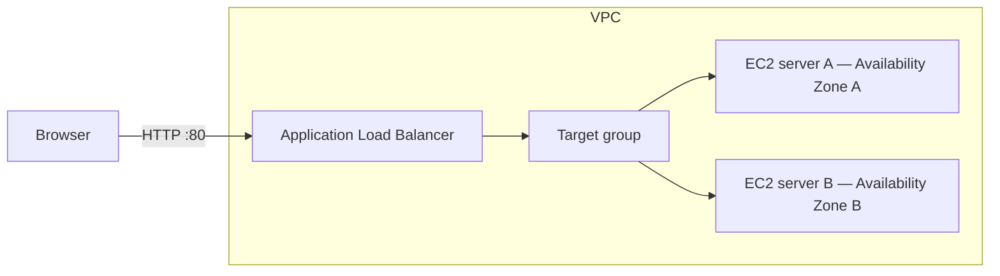
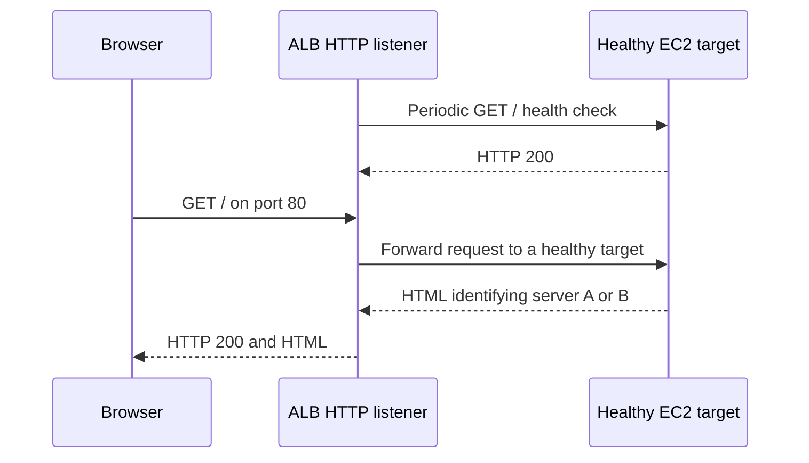

# Terraform ALB Lab: Two Servers, One Endpoint

Build a small website served by two EC2 instances behind an AWS Application Load Balancer (ALB), with infrastructure managed by Terraform.

**Time budget:** approximately two hours, assuming Terraform, the AWS CLI, and AWS authentication are already working.

This README describes the lab specification and intended outcomes. The Terraform configuration is still to be implemented.

## What we'll achieve

By the end of the lab, we'll have:

- One public URL that serves responses from two EC2 instances in different Availability Zones.
- Distinct pages that identify their server: `Hello from server A` and `Hello from server B`.
- Health checks that let the ALB direct requests to healthy targets.
- A failure experiment: stop one instance and confirm that the remaining healthy instance continues serving requests.
- Infrastructure we can provision, inspect, change, and remove with Terraform.
- An understanding of the request path, network boundaries, and common causes of failed requests.

## Architecture



The ALB spans two public subnets in different Availability Zones. Each subnet contains one EC2 instance. The diagram shows logical routing: a target group is a collection of destinations, rather than a separate server that proxies requests.



## Infrastructure specification

| Component | Specification | Purpose |
| --- | --- | --- |
| AWS region | One configurable region | Keep all lab resources together |
| VPC | One VPC, for example `10.0.0.0/16` | Provide the lab network |
| Subnets | Two public subnets, for example `10.0.1.0/24` and `10.0.2.0/24`, in different Availability Zones | Place resources across two zones |
| Internet gateway | One gateway attached to the VPC | Provide a path to the internet |
| Routing | Public route table with `0.0.0.0/0` routed to the internet gateway and associations for both subnets | Allow internet connectivity |
| EC2 instances | Two small instances using an AMI compatible with the selected instance type | Run the web servers |
| Instance startup | User data installs and starts Nginx and writes a distinct index page on each server | Configure servers automatically |
| Instance public IPs | Enabled for this lab | Allow package downloads during startup without a NAT gateway |
| ALB | Internet-facing Application Load Balancer attached to both public subnets | Expose a single entry point |
| Listener | HTTP on port 80 | Accept browser requests |
| Target group | Instance targets using HTTP on port 80, with both instances registered | Identify destinations |
| Health check | HTTP `GET /`, expecting status `200` | Check whether each web server can respond |
| ALB security group | Inbound TCP 80 from the internet; outbound TCP 80 to the instance security group | Permit client requests and forwarding/health checks |
| Instance security group | Inbound TCP 80 only from the ALB security group; outbound access for package installation | Limit direct access to the web servers |
| Terraform output | `alb_url`, containing the full HTTP URL | Make testing easy |
| Resource tags | Consistent project tags, such as `Project = terraform-alb-lab` | Identify lab resources during cleanup |

Public IPs support outbound bootstrap traffic; the instance security group still restricts inbound HTTP to the ALB. No SSH access is required for the planned lab.

## Prerequisites

- An AWS account and an authenticated AWS CLI profile with permission to create and remove the lab resources.
- Terraform and the AWS CLI installed locally.
- A chosen AWS region and two available Availability Zones.
- A browser or `curl` for testing.
- Familiarity with basic terminal commands and editing files.

Check authentication before starting:

```sh
aws sts get-caller-identity
```

Use an AWS CLI profile or your organization's supported authentication method. Keep credentials out of Terraform files and Git.

## Suggested project layout

```text
terraform-alb-lab/
├── README.md
├── main.tf          # Provider and infrastructure resources
├── variables.tf     # Region and instance settings
├── outputs.tf       # ALB URL
├── .gitignore       # Exclude local Terraform files and state
└── .terraform.lock.hcl # Commit after terraform init
```

Use plain Terraform resources for this first lab. Ignore `.terraform/`, `*.tfstate`, `*.tfstate.*`, saved plan files, and any local files containing secrets. State can contain sensitive values; preserve it locally until cleanup is complete.

## Two-hour plan

| Time | Task |
| --- | --- |
| 0–15 minutes | Verify credentials, choose a region, and review the architecture. |
| 15–40 minutes | Define the VPC, subnets, internet gateway, routing, and security groups. |
| 40–65 minutes | Define two EC2 instances and startup scripts that install Nginx and identify each server. |
| 65–90 minutes | Define the ALB, listener, target group, attachments, health checks, and URL output; apply the configuration. |
| 90–110 minutes | Send repeated requests, inspect target health, stop one instance, and observe traffic continuing through the other. |
| 110–120 minutes | Record findings, destroy the lab, and verify cleanup. |

## Terraform workflow

Once the configuration has been implemented:

```sh
terraform init
terraform fmt
terraform validate
terraform plan
terraform apply
terraform output -raw alb_url
```

Review the plan before applying. After deployment, allow time for instance startup, Nginx installation, and successful health checks.

## Experiments and acceptance criteria

### 1. Reach both servers through one endpoint

Open the ALB URL in a browser, then send multiple independent requests:

```sh
ALB_URL=$(terraform output -raw alb_url)
for i in $(seq 1 20); do
  curl --fail --silent --show-error "$ALB_URL"
  printf '\n'
done
```

**Success:** requests return HTTP 200 and the responses identify both server A and server B over a series of requests. Do not require strict A/B alternation or an exact 50/50 split.

### 2. Observe failure handling

1. Confirm both targets are healthy in the AWS console's target group view.
2. Stop one of the lab EC2 instances in the console.
3. Observe its target health transition and repeat requests to the ALB.
4. Confirm requests continue to return the remaining server's page after the ALB detects the failure.
5. Optionally restart the stopped instance and observe it return to service after passing health checks.

**Success:** the endpoint remains usable with one healthy target. Some requests may fail during failure detection. Stopping a server does not create a replacement; automatic replacement is a later autoscaling lesson. Keep at least one target healthy during this experiment: if all registered targets are unhealthy, an ALB can fail open and route to unhealthy targets.

### 3. Understand the access boundary

Compare the two security groups in the console or Terraform configuration. Optionally try HTTP against an instance's public IP using a short connection timeout.

**Success:** the ALB accepts public HTTP, while the instances accept HTTP only from the ALB's security group. A direct HTTP request from your computer should fail.

### 4. Clean up

```sh
terraform plan -destroy
terraform destroy
terraform state list
```

**Success:** Terraform reports successful destruction and no managed resources remain in state. Also inspect the AWS console in the selected region to confirm the lab ALB, instances, and networking resources have been removed. Terminated EC2 entries may remain visible temporarily.

## Basics we'll learn

| Concept | What you should be able to explain afterward |
| --- | --- |
| Region and Availability Zone | Where resources run and why placing servers across zones helps availability. |
| VPC, subnet, and CIDR | How the network is divided and how address ranges are assigned. |
| Routing and internet gateway | How traffic reaches the internet; why a public subnet alone does not give an instance internet access. |
| Security groups | How stateful firewall rules work and how one security group can reference another. |
| EC2 and user data | How a virtual machine is launched and configured automatically. |
| Listener, target group, and health check | Where requests enter, where they go, and how server readiness is assessed. |
| IAM and credentials | Which identity Terraform uses and which actions it can perform. |
| Terraform configuration and state | How declared resources map to real infrastructure and why state must be protected. |
| Terraform lifecycle | What `init`, `plan`, `apply`, and `destroy` do. |
| Troubleshooting | How to trace DNS → listener → security groups → target health → application. |

For failed requests, inspect target health first, then security group rules and whether startup finished successfully. A failed package installation can leave a running EC2 instance with no functioning web server.

## Cost and scope

This lab can incur charges for the ALB, EC2 instances, EBS storage, public IPv4 addresses, and data transfer. Pricing depends on the region and account eligibility; do not assume the lab is free. Destroy the resources when finished. Stopping the instances alone leaves other billable resources running.

The first lab uses HTTP and simple static pages. Follow-up labs can add HTTPS with ACM, a custom domain, private application subnets, an Auto Scaling Group, CloudWatch metrics and alarms, or path-based routing.

## References

- [AWS: Create an Application Load Balancer](https://docs.aws.amazon.com/elasticloadbalancing/latest/application/create-application-load-balancer.html)
- [AWS: Target group health checks](https://docs.aws.amazon.com/elasticloadbalancing/latest/application/target-group-health-checks.html)
- [AWS: ALB security groups](https://docs.aws.amazon.com/elasticloadbalancing/latest/application/load-balancer-update-security-groups.html)
- [Terraform AWS provider: ALB listener](https://registry.terraform.io/providers/hashicorp/aws/latest/docs/resources/lb_listener)
- [AWS: Elastic Load Balancing pricing](https://aws.amazon.com/elasticloadbalancing/pricing/)
