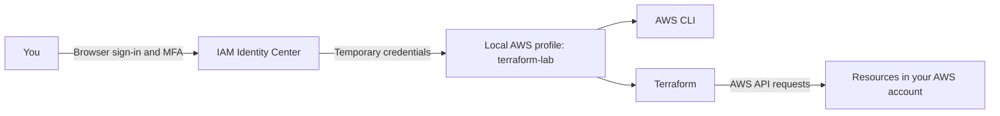
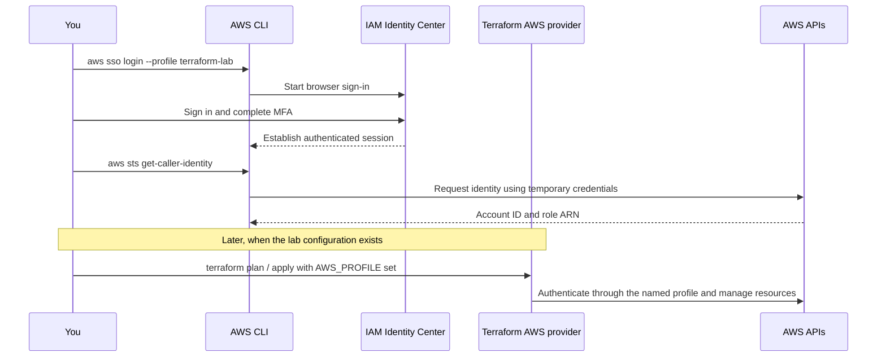

# AWS Setup for the Terraform ALB Lab

Get your AWS account and local tools ready before starting the [Terraform ALB lab](README.md).

**Time budget:** allow approximately 30–60 minutes in addition to the two-hour lab. Account verification may take longer.

This guide assumes a new personal learning account and a Mac. If you are using an employer's account, use its approved login and permission process instead.

## What we'll achieve

- A secured AWS account with multi-factor authentication (MFA).
- A budget notification to help track spending.
- An everyday login through IAM Identity Center.
- AWS CLI v2 and Terraform installed locally.
- A named profile, `terraform-lab`, that Terraform can use without credentials in the repository.
- A successful identity check before any infrastructure is created.

## How the tools connect





## 1. Create and secure your AWS account

1. Sign up at [AWS](https://aws.amazon.com/). Have your email, payment details, and phone available for verification.
2. Sign in to the AWS Management Console as the account's **root user**. This is the account owner and has full control.
3. Open **Security credentials** and enable MFA using a supported authenticator or security key.
4. Keep the root login for account administration. Use the everyday login created below for the lab; do not create root access keys.

Reference: [AWS root MFA instructions](https://docs.aws.amazon.com/IAM/latest/UserGuide/enable-mfa-for-root.html).

## 2. Set a spending alert

1. In the console, search for **Billing and Cost Management**.
2. Open **Budgets**, then choose **Create budget**.
3. Create a monthly cost budget, for example **US$5**.
4. Add your email address for notifications, such as at 50% and 100% of the budget.

A budget is an alert, not a spending cap. Notifications can lag behind usage. The lab can incur charges for the ALB, EC2 instances, storage, public IPv4 addresses, and data transfer. Do not assume it is free; remove resources after the lab with `terraform destroy`.

References: [Create a cost budget](https://docs.aws.amazon.com/cost-management/latest/userguide/create-cost-budget.html), [AWS Budgets limitations](https://docs.aws.amazon.com/cost-management/latest/userguide/budgets-managing-costs.html).

## 3. Create your everyday login

IAM Identity Center provides browser sign-in and temporary credentials for local tools.

1. Search for **IAM Identity Center** in the AWS console.
2. Enable an **organization instance**. If prompted, create an AWS Organization; you can begin with your single account.
3. Record the region where Identity Center is enabled. This is your **SSO region**.
4. Under **Users**, add yourself and choose the emailed password setup option.
5. Under **AWS accounts**, select your account and choose **Assign users or groups**.
6. Select your user, create a predefined permission set using `AdministratorAccess`, and submit the assignment. Alternatively, assign a group containing your user, as in AWS's walkthrough.
7. Complete the emailed invitation and set your password.
8. Configure MFA for the Identity Center user. In Identity Center **Settings**, review multi-factor authentication and require MFA for sign-in.
9. Record the **AWS access portal URL** and sign in through it to verify you can access the account and assigned role.

`AdministratorAccess` grants broad permissions. It is a convenient starting point for this dedicated personal learning account; use a more restricted permission set as you learn IAM. Do not apply this recommendation to a shared or production account.

Choose an organization instance for this workflow. An account instance does not provide the AWS account role access needed by this lab.

References: [Identity Center instance types](https://docs.aws.amazon.com/singlesignon/latest/userguide/identity-center-instances.html), [AWS user and permission setup walkthrough](https://docs.aws.amazon.com/singlesignon/latest/userguide/quick-start-default-idc.html).

## 4. Install AWS CLI v2 and Terraform

### AWS CLI

Use the macOS installer linked from the [official AWS CLI installation instructions](https://docs.aws.amazon.com/cli/latest/userguide/getting-started-install.html).

Verify installation:

```sh
aws --version
```

The output should begin with `aws-cli/2`.

### Terraform

If you already use Homebrew:

```sh
brew tap hashicorp/tap
brew install hashicorp/tap/terraform
```

Otherwise, follow [HashiCorp's Terraform installation instructions](https://developer.hashicorp.com/terraform/install) for macOS.

Verify installation:

```sh
terraform version
```

## 5. Configure a named AWS profile

Run:

```sh
aws configure sso --profile terraform-lab
```

Use these values in the wizard:

| Prompt | Value |
| --- | --- |
| SSO session name | `personal-lab` |
| SSO start URL | Your Identity Center AWS access portal URL |
| SSO region | The region where you enabled Identity Center |
| SSO registration scopes | Accept the default, `sso:account:access` |
| AWS account | Select your learning account |
| Role | Select the assigned permission set, such as `AdministratorAccess` |
| Default client region | `us-east-1`, or another region you choose for the lab |
| Default output format | `json` |
| Profile name, if prompted | `terraform-lab` |

The wizard opens your browser to authorize access. The **SSO region** identifies your login service; the **client region** is where AWS CLI requests run by default. These can differ. Configure the Terraform provider to use your chosen lab region as well.

Reference: [Configure AWS CLI SSO authentication](https://docs.aws.amazon.com/cli/latest/userguide/cli-configure-sso.html).

## 6. Sign in and verify access

```sh
aws sso login --profile terraform-lab
export AWS_PROFILE=terraform-lab
aws sts get-caller-identity
```

Expected output has this shape; your values will differ:

```json
{
  "UserId": "your-session-identity",
  "Account": "123456789012",
  "Arn": "arn:aws:sts::123456789012:assumed-role/your-role/your-session"
}
```

Confirm that `Account` is your intended learning account. Terraform's AWS provider can use the named profile selected by `AWS_PROFILE`; do not put access keys in Terraform files or commit credentials to Git.

The `export` applies to the current terminal session. In a new terminal, set it again. When your login expires, run `aws sso login --profile terraform-lab` again.

Reference: [Terraform AWS provider authentication](https://registry.terraform.io/providers/hashicorp/aws/latest/docs).

## Troubleshooting

| Symptom | Check |
| --- | --- |
| `aws: command not found` | Complete AWS CLI installation and reopen your terminal. |
| `terraform: command not found` | Complete Terraform installation and reopen your terminal. |
| No account or role appears during SSO setup | Confirm the user has an account assignment in an organization instance of Identity Center. |
| SSO setup cannot find your login service | Confirm the portal URL and SSO region match Identity Center settings. |
| Login token expired | Run `aws sso login --profile terraform-lab` again. |
| Unable to locate credentials | Set `AWS_PROFILE=terraform-lab`, or test with `aws sts get-caller-identity --profile terraform-lab`. |
| Identity check shows an unexpected account | Stop before provisioning; check the selected profile and any existing credential environment variables. |
| Terraform reports access denied | Confirm the account assignment and permissions used by the profile. |

## Ready for the lab

Setup is complete when:

- Root and everyday sign-ins have MFA configured.
- Your budget notifications are configured.
- `aws --version` reports CLI v2 and `terraform version` succeeds.
- `aws sts get-caller-identity` succeeds and identifies the intended account and role.

Return to the [lab README](README.md) to build the infrastructure. You do not need to create the VPC, EC2 instances, or ALB manually; the lab's Terraform configuration will create them.
